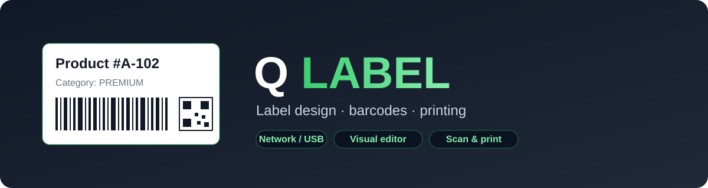

<div align="center">



# Q LABEL

**โปรแกรมออกแบบและพิมพ์ฉลาก · เวอร์ชัน v1.330**

[](CHANGELOG.md)
[](LICENSE)
[](https://www.electronjs.org/)

</div>

Q LABEL เป็นแอปสำหรับออกแบบฉลากบนคอมพิวเตอร์ เพิ่มข้อความ บาร์โค้ด QR code รูปภาพและรูปทรง แล้วดูตัวอย่างก่อนส่งงานพิมพ์ เหมาะกับงานฉลากที่ใช้เครื่องพิมพ์ Zebra และงานที่ต้องใช้ข้อมูลจากไฟล์หรือฐานข้อมูล

## ความสามารถหลัก

- ออกแบบฉลากด้วยตัวแก้ไขแบบลากวาง พร้อมปรับขนาด ตำแหน่ง หน้าและระยะขอบ
- เพิ่มข้อความ บาร์โค้ด QR code รูปภาพ SVG ตาราง และรูปทรง พร้อมตัวอย่างบนหน้าจอ
- ใช้วัตถุที่เพิ่งใช้ซ้ำได้จากแถบ Recently Used Objects ซึ่งจัดเป็นสองคอลัมน์ใน v1.330
- เชื่อมข้อมูลจากไฟล์และฐานข้อมูลเพื่อใช้กับฉลาก; การเชื่อมต่อบางประเภทต้องมีไดรเวอร์และการตั้งค่าของระบบ
- บันทึกเอกสารเป็น `.qlabel` และส่งออกในรูปแบบต่าง ๆ เช่น PDF, PNG และ SVG
- ส่งงานพิมพ์ผ่านชื่อเครื่องพิมพ์บน Windows หรือผ่านเครือข่าย และใช้ CLI สำหรับงานพิมพ์อัตโนมัติ

ดูรายการเปลี่ยนแปลงเพิ่มเติมใน [CHANGELOG.md](CHANGELOG.md)

## เริ่มใช้งานจาก source

ติดตั้ง [Node.js](https://nodejs.org/) เวอร์ชัน 20 ขึ้นไปและ Git จากนั้นเปิด Terminal:

```bash
git clone https://github.com/st651102064101-design/Q-Label.git
cd Q-Label
npm install
npm start
```

สำหรับการพิมพ์ผ่านชื่อเครื่องพิมพ์บน Windows ให้ติดตั้งและตั้งค่าเครื่องพิมพ์ใน Windows ก่อนใช้งาน

## สร้างโปรแกรมสำหรับ Windows

หลังติดตั้ง dependencies แล้ว ใช้คำสั่งนี้เพื่อสร้างตัวติดตั้ง:

```bash
npm run dist
```

ไฟล์ที่สร้างอยู่ในโฟลเดอร์ `dist` สามารถตรวจสอบไฟล์ที่เผยแพร่แล้วได้ที่ [Releases](https://github.com/st651102064101-design/Q-Label/releases)

## ตัวอย่าง CLI

```bash
node cli.js list-templates
node cli.js list-printers
node cli.js print --template product-51x25 --printer "Zebra" --set title="Product" --set code=12345
```

ดูตัวเลือกทั้งหมดด้วย `node cli.js --help` และทดสอบการเชื่อมต่อกับเครื่องพิมพ์ที่ใช้งานจริงก่อนส่งงานผลิต

## การทดสอบ

```bash
npm run test:basic
```

การตรวจล่าสุดของ v1.330 ผ่าน 1,393 จาก 1,402 unit tests และมี 9 รายการเดิมที่ยังล้มเหลวในส่วน barcode picker, database catalog และ Page Setup; การตรวจพื้นฐานทั้งสามขั้นตอนผ่าน ดูรายละเอียดใน [UNIT_TEST_BASIC.md](UNIT_TEST_BASIC.md) การทดสอบเหล่านี้ไม่ได้ยืนยันผลจากเครื่องพิมพ์หรือฐานข้อมูลจริงทุกชนิด

## ที่มาและสัญญาอนุญาต

Q LABEL พัฒนาต่อยอดจาก [LabelForge](https://github.com/dextsamu/labelforge) และเผยแพร่ภายใต้ [MIT License](LICENSE)
